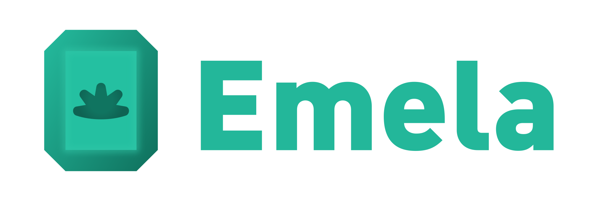

# Emela のロゴ

ロゴは、「Emela」という名前の由来であるエメラルドをモチーフにしています。

エメラルドには、機械的にカッティングされた八角形と、人間の手によって付けられた曲線的な手形という、二つの異なる形を重ねています。規則的な八角形は「コンピュータ」を、柔らかな曲線を持つ手形は「人間」を象徴しており、Emelaを開発するきっかけとなった「AIにも人間にもやさしい言語」という考えを込めています。

さらに、八角形の「8」と手の指の「5」にも意味を持たせています。八角形の8は、コンピュータで用いられる8進数や16進数を、5本の指は両手で10本となることから、人間が日常的に使う10進数を連想させます。

機械によって整えられた形と、人間の手によって残された形。この二つを一つのエメラルドに重ねることで、AIと人間が互いに理解できる形で処理を記述するという、Emelaの目指す姿を表現しています。

## バリエーション

|                    アイコン                    |             名前              |        用途        |
| :--------------------------------------------: | :---------------------------: | :----------------: |
|             |    `emela-logo.{png,svg}`     |     通常のロゴ     |
|  |  `emela-logo-wide.{png,svg}`  |   言語名付きロゴ   |
|    | `emela-logo-simple.{png,svg}` | 小さいアイコン向け |

## カラーコード

|        名前         |          OKLCH           | sRGB (HEX) |
| :-----------------: | :----------------------: | :--------: |
| Emela Emerald Light | `oklch(0.725 0.130 175)` | `#24c0a1`  |
| Emela Emerald Main  | `oklch(0.700 0.125 175)` | `#23b79a`  |
| Emela Emerald Dark  | `oklch(0.500 0.090 175)` | `#107460`  |
| Emela Emerald Deep  | `oklch(0.450 0.080 175)` | `#0f6353`  |

## ライセンス

このロゴは、[CC0 1.0 Universal](https://creativecommons.org/publicdomain/zero/1.0/deed.ja) に基づき、パブリックドメインに提供されています。商用・非商用を問わず、自由に使用、改変、再配布できます。

ロゴの文字部分には、Adobe Fontsで提供されている「FF DIN Paneuropean Black」を使用しています。

配布しているロゴの文字はアウトライン化されており、ロゴをそのまま使用したり、図形として編集したりするために、別途フォントのライセンスを取得する必要はありません。

ただし、このフォント自体はCC0の対象ではありません。新たに同じフォントを使用して文字を作成・編集する場合は、フォントの利用条件を確認してください。
